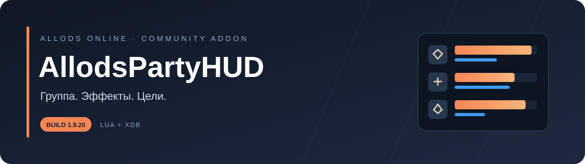

<p align="center">
  
</p>

<p align="center">
  
  
  
  
</p>

<h1 align="center">AllodsPartyHUD</h1>
<p align="center"><strong>Группа, эффекты и цели — в настраиваемом интерфейсе «Аллодов Онлайн».</strong></p>
<p align="center">
  <a href="https://github.com/imwa89/AllodsPartyHUD/releases/tag/v1.9.20">Скачать сборку</a> ·
  <a href="#установка">Установка</a> ·
  <a href="docs/SETTINGS.md">Настройка</a> ·
  <a href="https://github.com/imwa89/AllodsPartyHUD/issues/new/choose">Сообщить об ошибке</a>
</p>

## Возможности

| Блок | Что умеет |
| --- | --- |
| **Панель группы** | До 6 участников, здоровье и щиты в процентах, иконки классов. |
| **Бафы и дебафы** | Именованные списки эффектов для союзников и врагов, расположение и мигание иконок. |
| **Откаты** | Отслеживание наблюдаемых применений; время из доступных игровых данных или заданное вручную. |
| **Метка цели** | Настраиваемая 3D-метка выбранного союзника, врага или моба. |
| **Обзор персонажей** | Отдельный список видимых юнитов, категории и постраничный просмотр. |
| **Внешний вид** | Цвета, размеры строк и иконок, отступы, перемещение панелей и блокировка позиции. |
| **Предпросмотр** | Демонстрационная группа для настройки интерфейса без сбора игроков. |
| **Обмен настройками** | Текстовый код APH1, проверка перед импортом, объединение или замена настроек. |

## Установка

1. Откройте [релиз v1.9.20](https://github.com/imwa89/AllodsPartyHUD/releases/tag/v1.9.20) и скачайте **AllodsPartyHUD_v1.9.20.zip** из раздела Assets.
2. Распакуйте папку **AllodsPartyHUD** в `data/Mods/Addons` внутри папки игры.
3. Проверьте итоговый путь:

   ```text
   Allods Online/
   └── data/Mods/Addons/
       └── AllodsPartyHUD/
           ├── AddonDesc.(UIAddon).xdb
           ├── Scripts/
           └── Widgets/
   ```

4. Включите дополнение в игровом меню аддонов. При необходимости перезапустите клиент.
5. Откройте настройки через кнопку **«ГРУППА»** или кнопку настроек на панели группы.

Не помещайте в `Addons` внешнюю папку архива или весь репозиторий: файл `AddonDesc.(UIAddon).xdb` должен лежать непосредственно внутри `AllodsPartyHUD`.

Стандартная папка и включение аддонов описаны в [официальном FAQ Allods Online](https://allods.my.games/en/game/faq).

## Быстрый старт

- Откройте настройки и выберите **«ПРОСМОТР»**, чтобы настроить демонстрационную группу.
- В **«ОБЩЕЕ»** настройте размеры и цвета. Для реальных участников переключитесь на **«МОЯ ГРУППА»**.
- Добавьте нужные эффекты по точному игровому названию и задайте правила отображения.
- Во вкладке **«ОТКАТЫ»** выберите автоматическое время или формат `Название=секунды`.
- Во вкладке **«ОБМЕН»** сохраните текстовый код настроек или импортируйте чужой.

Подробности: [настройка и обмен профилями](docs/SETTINGS.md).

## Статус сборки

Это экспериментальный community-аддон. Публикация сохраняет файлы предоставленной сборки без изменения игровой логики; проверка в игровом клиенте при подготовке репозитория не проводилась.

- Обозначение **1.9.20** взято из имени исходной папки. Внутри остались более старые значения: комментарий `v1.9.15` в `Main.lua`, `19915` в XDB-манифесте и `v1.6` в исходном README.
- Щит показывается через `GetHealthInfo().additionalPercents`; это процентный индикатор, а не подтверждённое поглощение в единицах HP.
- Откаты зависят от наблюдаемых событий и данных, доступных игровому API.
- APH1 не совместим с кодами ADSC / Universe. Положение панелей не переносится через экспорт.
- Манифест ссылается на клиентский `/Mods/SampleCommon/SampleAddonBase.lua`; этот файл не входит в архив.

## Обратная связь

Нашли проблему? [Создайте issue](https://github.com/imwa89/AllodsPartyHUD/issues/new/choose): укажите версию клиента, шаги воспроизведения, ожидаемое поведение и приложите скриншот или текст ошибки.

## Для разработчиков

```text
AllodsPartyHUD/     Устанавливаемый аддон: Lua, XDB и текстуры
docs/              Руководство и оформление страницы
.github/           Шаблоны сообщений об ошибках и предложений
CHANGELOG.md       История публикаций
THIRD_PARTY.md     Авторы и сторонние компоненты
```

`Scripts/Main.lua` содержит текст в Windows-1251. Перед правкой проверяйте кодировки; не перекодируйте игровые ресурсы автоматически.

## Авторы и сторонние ресурсы

Публикация и сопровождение репозитория — [imwa89](https://github.com/imwa89). В исходном манифесте автор указан как `Community prototype`.

Иконки классов основаны на Universe by **OLDodin** (2018, MIT). **LibDnD** — **SLA**, обновление **hal.dll**. Исходные уведомления и лицензия сохранены. Подробности — [THIRD_PARTY.md](THIRD_PARTY.md).

Общая лицензия для всего проекта в исходной сборке не указана. MIT-уведомление Universe относится к соответствующим сторонним ресурсам. Графика и названия игры принадлежат их правообладателям.
